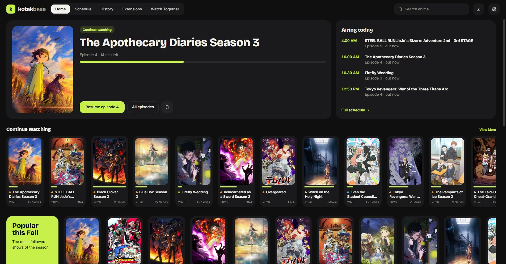
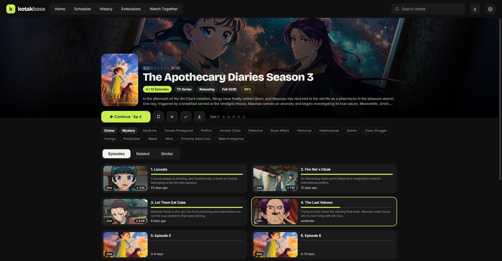
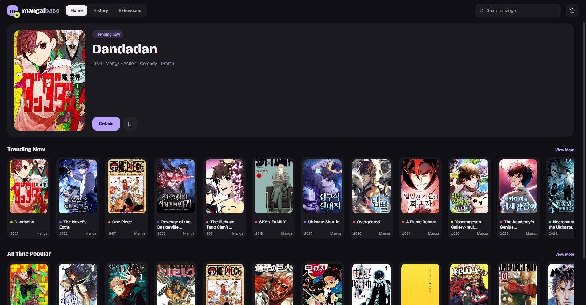
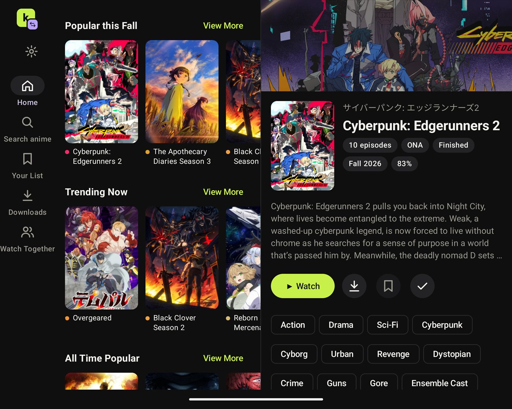
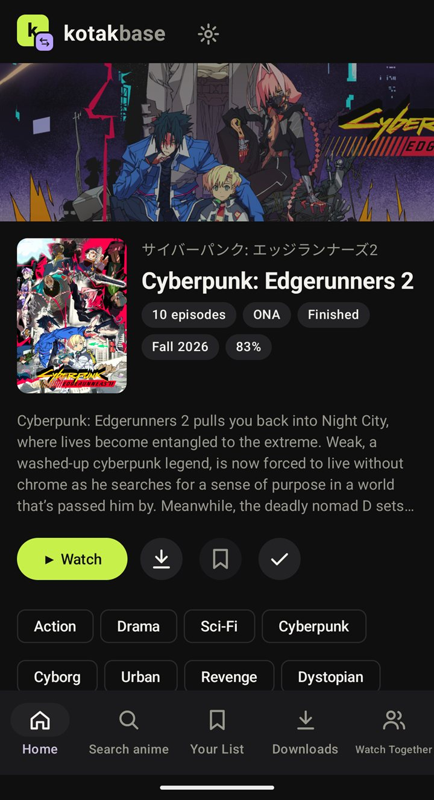

# Kotakbase

An app for streaming anime from torrents and reading manga, for Windows, Linux and [Android](https://github.com/runley/kotakbase-android). It plays episodes while they download, tracks what you watch and read, and can sync your progress with AniList.



- **Watch while it downloads**: pick a source and the episode starts in seconds; Auto Select picks one for you.
- **Your shows in one place**: Continue Watching, Your List, a weekly schedule and history, synced with AniList.
- **Watch Together**: watch with friends on other devices; pausing, playing and seeking happen for everyone, and there's a chat.
- **Downloads**: save a season or single episodes to watch offline.
- **Manga**: tap the logo to switch to manga mode, with AniList's manga, your own manga list and a reader (vertical strip, or paged right to left or left to right) that marks chapters read.
- **Updates itself** from this page's releases.
- **In your language**: English, Українська, Қазақша, Русский, Deutsch, Español, 简体中文, 繁體中文 and 日本語, following your system language (or pick one in Settings).





## Android

[Kotakbase for Android](https://github.com/runley/kotakbase-android) is a native app with the same features: streaming, manga, AniList sync, downloads and Watch Together with desktop users. It works on any phone with Android 8 or newer and is made for foldables: unfolded, a show opens beside the page you're on and the reader shows two pages; folded, everything moves to one screen. Get the APK from its [releases](https://github.com/runley/kotakbase-android/releases).

<p>
  
  
</p>

Kotakbase comes with no sources. It finds episodes through extensions in the Hayase extension format, and chapters through manga extensions: paste an extension link under **Extensions** to add one. Kotakbase doesn't host, index or link to any content.

## Install

Download the latest `Kotakbase-Setup-*.exe` (Windows) or `.AppImage` (Linux) from [Releases](https://github.com/runley/kotakbase/releases). Windows may show a SmartScreen warning; choose "More info" → "Run anyway". Kotakbase updates itself after that. For Android, see [kotakbase-android](https://github.com/runley/kotakbase-android/releases).

## Run from source

```bash
npm install
npm start
```

Or double-click `Kotakbase.bat`.

The MyAnimeList fallback and AniList sign-in need API client ids: copy `secrets.example.json` to `secrets.local.json` and fill them in. Without them Kotakbase still runs, using AniList only and without sign-in.

## Build the installer

```bash
npm run dist
```

The installer is written to `dist\`.

## Tests

```bash
npm test
```

## Disclaimer

Kotakbase is a player. It doesn't host, store, index or link to any video, and the project has no content of its own. Show and manga information comes from AniList and MyAnimeList; where to watch comes from extensions, which are made and published by third parties, not by Kotakbase, and which you choose to install. You're responsible for what you watch and download, and for following the laws where you live. Rights holders with a concern about a specific source should contact whoever runs that source or extension.

## Licence

MIT, see [LICENSE](LICENSE). Also see the [Terms of Service](docs/terms.md), [Privacy Policy](docs/privacy.md) and [Code Signing Policy](docs/code-signing.md). Third-party software Kotakbase ships is listed in [THIRD_PARTY_NOTICES.txt](THIRD_PARTY_NOTICES.txt) and [licenses/](licenses).
