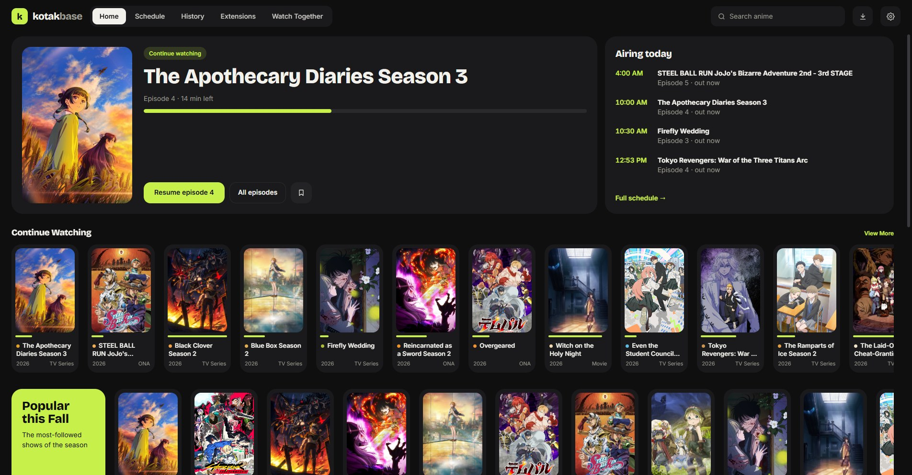
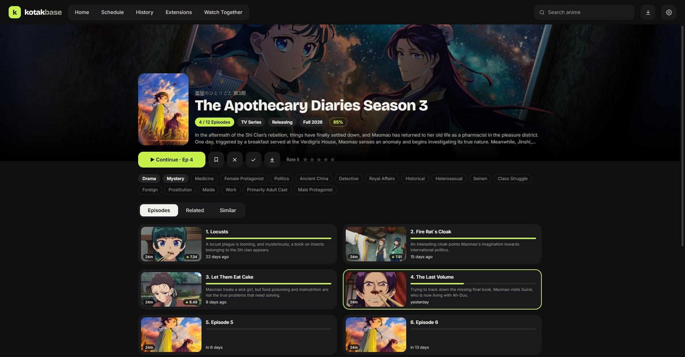

# Kotakbase

A Windows desktop app for streaming anime from torrents. It plays episodes while they download, tracks what you watch, and can sync your progress with AniList.



- **Watch while it downloads**: pick a source and the episode starts in seconds; Auto Select picks one for you.
- **Your shows in one place**: Continue Watching, Your List, a weekly schedule and history, synced with AniList.
- **Watch Together**: watch with friends on other devices; pausing, playing and seeking happen for everyone, and there's a chat.
- **Downloads**: save a season or single episodes to watch offline.
- **Updates itself** from this page's releases.



Kotakbase comes with no sources. It finds episodes through extensions in the Hayase extension format: paste an extension link under **Extensions** to add one. Kotakbase doesn't host, index or link to any content.

## Install

Download the latest `Kotakbase-Setup-*.exe` from [Releases](https://github.com/runley/kotakbase/releases). Windows may show a SmartScreen warning; choose "More info" → "Run anyway". Kotakbase updates itself after that.

## Run from source

```bash
npm install
npm start
```

Or double-click `Kotakbase.bat`.

The MyAnimeList fallback and AniList sign-in need API client ids: copy `secrets.example.json` to `secrets.local.json` and fill them in. Without them Kotakbase still runs, using AniList only and without sign-in.

## Build the installer

```bash
npm run dist
```

The installer is written to `dist\`.

## Tests

```bash
npm test
```

## Licence

MIT, see [LICENSE](LICENSE). Third-party software Kotakbase ships is listed in [THIRD_PARTY_NOTICES.txt](THIRD_PARTY_NOTICES.txt) and [licenses/](licenses).
